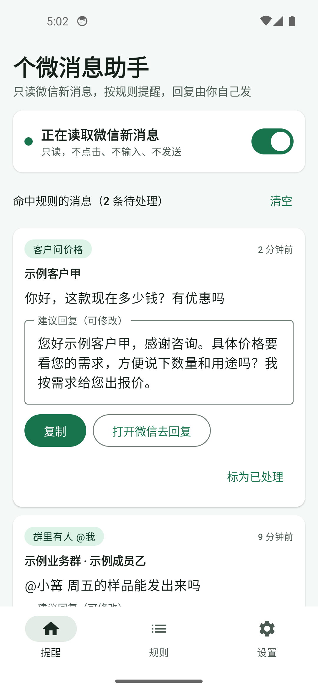
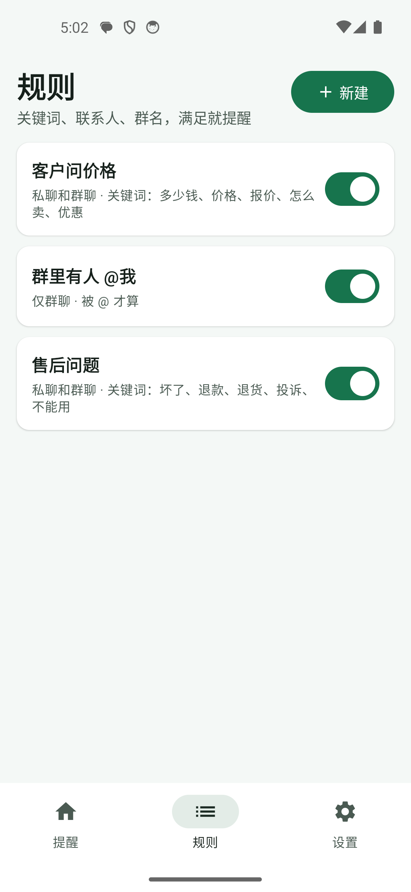
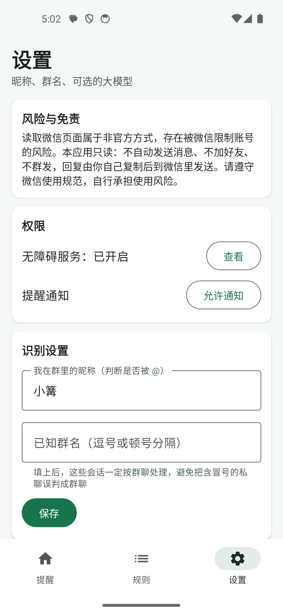

# 个微消息助手（安卓）

> 篝火出品 · 收录于篝火 App 应用区。本工具开源，全部工具见 [toolkit-hub](https://github.com/campfire-code/toolkit-hub)。

装在安卓手机上，用无障碍服务**只读**个人微信的新消息（通知和聊天列表上的预览文字），按你设置的关键词、联系人、群名规则分类，在本应用里汇总提醒，例如「有客户问价格」「群里有人 @ 你」。每条命中的消息给出建议回复：固定话术模板，或（可选）用你自己填的大模型生成；你点「复制」，再点「打开微信去回复」，由你自己发送。原生安卓应用，没有服务器，不上报任何数据。

<p>



</p>

> 截图为模拟器里的示例：联系人、群和消息都是虚构的；为了截图，演示模式下「无障碍服务」直接显示为已开启，模拟器里没有安装微信。

## 风险与免责

**使用前请先读完这一节。**

- **读取微信页面属于非官方方式，存在被微信限制账号的风险。** 请遵守微信使用规范，风险由使用者自行承担，作者不提供任何担保。建议用小号或不重要的账号先试。
- 本应用**只读**：不点击、不输入、不发送任何消息，不自动加好友，不群发，不自动打招呼。无障碍配置里没有申请手势、截图能力，代码里没有调用任何点击、输入或全局动作。
- **无障碍权限能读取被授权应用的界面内容。** 本应用的服务只接收微信（`com.tencent.mm`）一个应用的事件；规则、设置和命中的消息只存在本机，不上传。没有命中规则的消息不会保存，最多保留最近 300 条提醒，可随时清空。
- 使用「AI 生成建议」时，会把规则名、私聊/群聊和**这一条消息的文字**发到你自己填的接口（不发联系人名、群名）。消息文字里如果本身带姓名、电话等，也会一并发出。不想发出就不要填大模型接口。密钥只存在本机，不写日志。
- 请只用于你自己的账号和自己的手机，不要用来读取他人不知情的聊天。

## 能做什么

| 功能 | 说明 |
|---|---|
| 读新消息 | 微信弹出的消息通知；微信在前台时，聊天列表里带未读数（或「[N条]」前缀）的会话预览 |
| 规则分类 | 关键词（任一命中）、排除词、联系人、群名、仅私聊/仅群聊、群里被 @ 我才算；不同类别同时满足；全半角、大小写不敏感 |
| 汇总提醒 | 命中后出现在「提醒」页，并弹一条本机通知；可标为已处理、清空 |
| 去重 | 同一条消息在通知和聊天列表里反复出现只提醒一次；超过 30 分钟没再看到才算新消息 |
| 建议回复 | 话术模板变量：`{联系人}` `{群名}` `{消息}` `{关键词}` `{时间}` `{我的昵称}`；建议回复可在框里修改 |
| 可选大模型 | 设置页填 https 接口地址、密钥、模型名（兼容 OpenAI 的 chat/completions 格式），点「AI 生成建议」才联网 |
| 辅助回复 | 「复制」写入剪贴板；「打开微信去回复」只是打开微信，发送由你自己操作 |

不做：激活码与套餐、代理分销、远程下发指令、自建服务器上报、自动打招呼、自动对话、自动发送。

默认带三条示例规则：客户问价格、群里有人 @我、售后问题，可以改、可以删。

## 下载安装

1. 打开本仓库的 [Releases](https://github.com/campfire-code/wechat-message-assistant/releases)，下载 `wechat-message-assistant_<版本>_android.apk`。`SHA256SUMS.txt` 是校验值。
2. 在手机上点开安装；系统提示未知来源时，按提示允许当前浏览器或文件管理器安装。
3. 要求安卓 8.0（API 26）及以上。

## 怎么用

1. 打开应用，到「设置」页点「去开启」，在系统无障碍列表里找到「个微消息助手」并打开。安卓 13 及以上通过安装包手动安装时，系统可能把它列为「受限设置」，需先在系统的应用详情页右上角菜单选「允许受限设置」（系统机制，未在真机上验证，以你手机为准）。
2. 「设置」页点「允许通知」，让命中提醒能弹出来。
3. 填「我在群里的昵称」（用于判断是否被 @）；有群名的话填进「已知群名」，避免误判。
4. 到「规则」页改规则和话术，或新建。
5. 正常使用微信。命中规则的消息会出现在「提醒」页，点「复制」，再点「打开微信去回复」，粘贴发送。
6. 想暂停就关掉「提醒」页上的开关。

## 限制（请知悉）

- **没有在真实微信上验证过。** 通知文字格式（群聊为「发言人: 内容」）和聊天列表的页面结构，是按常见形式写的启发式解析，且靠控件位置和文字形态而不是微信内部控件 id；微信版本不同可能解析不出来，解析不出来时就是没有提醒，不会报错或乱发。
- 微信若设置了「通知不显示消息详情」，通知里读不到内容；此时只能靠聊天列表（需要微信在前台）。
- 只有红点没有数字的会话读不到未读数；通知被系统省电策略拦截时也读不到，请把本应用设为不受电池优化限制（各品牌菜单不同）。
- 群聊与私聊的判断：已知群名优先，其余按「昵称: 内容」猜测。
- 语音、图片等只能看到「[语音]」「[图片]」这类预览文字。

## 验收用例

自动化测试（45 个）：`./gradlew testDebugUnitTest`，覆盖规则匹配、去重、模板填充、通知与聊天列表解析、大模型请求构造与解析（假传输，不联网）。聊天列表解析用的是虚构节点树 `app/src/test/resources/chat_list.json`（5 个会话）和 `chat_page.json`（聊天页，应解析出空）。

在手机上手工验收（不需要对方真人，用另一个小号发消息）：

1. 开启无障碍和通知权限，保持默认规则。小号给你发「这个多少钱」→ 几秒内出现一条「客户问价格」提醒和本机通知，建议回复里的 `{联系人}` 已替换成小号的备注/昵称。
2. 小号再发同样的内容，并回到聊天列表 → 不重复提醒。
3. 在设置里填你的群昵称，小号在群里发「@你的昵称 在吗」→ 出现「群里有人 @我」；不 @ 你的消息不提醒。
4. 点「复制」后到任意输入框粘贴 → 得到建议回复；点「打开微信去回复」→ 打开微信，**没有任何消息被自动发出**。
5. 关掉「提醒」页的开关，小号再发「价格」→ 没有新提醒。
6. 设置里不填大模型 → 提醒卡片上没有「AI 生成建议」；填好 https 接口、密钥、模型后出现该按钮，点后建议回复被替换（接口需自行可用）。

## 自己构建

```
./gradlew testDebugUnitTest lint assembleDebug
```

需要 JDK 17、Android SDK（compileSdk 35）。发版由 `v*` 标签触发组织的 `android-release.yml`，签名密钥只从环境变量读取。

## 许可证

MIT，见 [LICENSE](LICENSE)；第三方库见 [THIRD_PARTY_LICENSES.md](THIRD_PARTY_LICENSES.md)。
